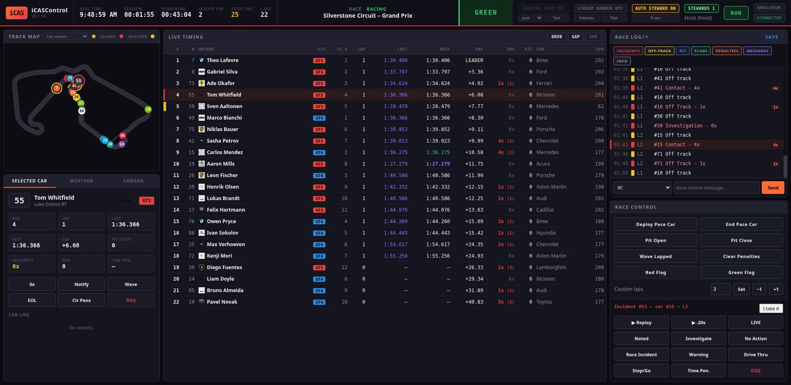
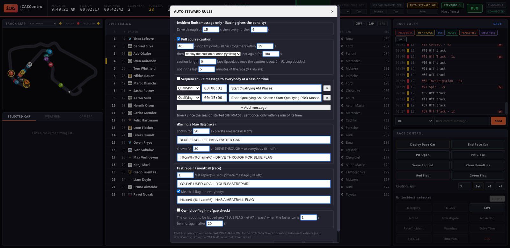
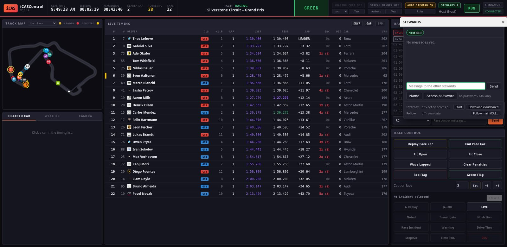

# iCASControl – Anleitung (Deutsch)

iCASControl ist unser eigenes Rennleitungs- und Steward-Programm für iRacing-Ligen,
nach dem Vorbild von iRaceControl. Es zeigt Live-Timing, eine Streckenkarte und ein
Rennlog mit allen Vorfällen. Es schickt Strafen und Rennleitungs-Befehle direkt in
den iRacing-Chat und ruft mit dem Auto Steward selbstständig Cautions aus. Mehrere
Stewards können gleichzeitig arbeiten, auch übers Internet.

iCASControl ist Teil der **iRacing-Overlay-App**. Es wird mit ihr installiert und
aktualisiert und im selben Launcher gestartet.



---

## Inhalt

1. [Voraussetzungen](#1-voraussetzungen)
2. [Installation der iRacing-Overlay-App](#2-installation-der-iracing-overlay-app)
3. [iCASControl starten](#3-icascontrol-starten)
4. [Updates](#4-updates)
5. [Die Oberfläche](#5-die-oberfläche)
6. [Vorfälle und Entscheidungen](#6-vorfälle-und-entscheidungen)
7. [Replay](#7-replay)
8. [Befehle in den iRacing-Chat](#8-befehle-in-den-iracing-chat)
9. [Rennleitung: Pace Car, Boxengasse, Caution-Runden](#9-rennleitung-pace-car-boxengasse-caution-runden)
10. [Auto Steward und Sequencer](#10-auto-steward-und-sequencer)
11. [Entscheidungen im Stream (Banner und Tower)](#11-entscheidungen-im-stream-banner-und-tower)
12. [Mehrere Stewards](#12-mehrere-stewards)
13. [Speichern und Neustart während des Rennens](#13-speichern-und-neustart-während-des-rennens)
14. [Fehlerbehebung](#14-fehlerbehebung)
15. [Wo die Einstellungen liegen](#15-wo-die-einstellungen-liegen)

---

## 1. Voraussetzungen

- **Windows-PC mit iRacing.** iCASControl liest die Daten direkt aus dem laufenden
  iRacing. Ohne iRacing läuft ein eingebauter Simulator (zum Üben).
- **Der iRacing-Account auf diesem PC muss Admin der Session sein**, wenn du:
  - die offiziellen Incident-Punkte (1x / 2x / 4x) aller Fahrer **live** sehen willst
    (als Zuschauer schickt iRacing sie erst am Rennende),
  - Strafen und Befehle in den iRacing-Chat schicken willst.

  Deshalb läuft der **Haupt-iCAS** auf dem Rechner des Admins, nicht unbedingt auf
  dem Stream-PC.
- In iRacing unter **Optionen → Grafik** die Einstellung **Max Cars auf 63** stellen,
  damit iRacing Daten für das ganze Feld liefert.
- iRacing und iCASControl entweder beide **ohne** oder beide **mit**
  Administratorrechten starten (normal: beide ohne).
- Internet nur für die Installation, für Updates und für Stewards außerhalb deines
  Heimnetzes.

---

## 2. Installation der iRacing-Overlay-App

Die Installation richtet Python, alle Pakete und eine Verknüpfung ein. Sie wird
**einmal** gemacht; danach kommen Updates per Knopfdruck.

### Variante A – mit ZIP-Datei

1. Die ZIP-Datei laden:
   <https://github.com/halvar20000/iracing-overlays/archive/refs/heads/main.zip>
2. Entpacken (Rechtsklick → *Alle extrahieren*).
3. Im entpackten Ordner **`install.bat`** doppelklicken.

### Variante B – ohne ZIP

PowerShell öffnen (Startmenü → „PowerShell“) und diese Zeile einfügen:

```
powershell -ExecutionPolicy Bypass -c "irm https://raw.githubusercontent.com/halvar20000/iracing-overlays/main/install.ps1 | iex"
```

### Was der Installer macht

1. Er sucht **Python 3.10 oder neuer**. Fehlt es, installiert er Python 3.12 über
   `winget` (Windows fragt eventuell nach einer Bestätigung).
2. Er fragt nach dem **Installationsordner**. Der Vorschlag
   `C:\Users\<du>\iRacing-Overlays` passt.
3. Er lädt die aktuelle Version von GitHub und installiert die Python-Pakete. Das
   dauert beim ersten Mal ein paar Minuten.
4. Er legt die Verknüpfung **„iRacing Overlays“** auf dem Desktop und im Startmenü an.

`install.bat` kann jederzeit erneut laufen (Reparatur). Deine Einstellungen bleiben
dabei erhalten.

---

## 3. iCASControl starten

1. **„iRacing Overlays“** auf dem Desktop doppelklicken. Der Launcher öffnet sich
   mit einer Zeile pro Overlay.
2. In der Zeile **„Race Control (iCAS)“** auf **Start** klicken. Der Punkt wird grün.
3. Auf **Open** klicken oder im Browser **<http://localhost:8080>** öffnen.

Tipps:

- iRacing darf vor oder nach iCASControl gestartet werden. Läuft iRacing nicht, zeigt
  iCASControl den **Simulator** (Silverstone, GT3 + GT4). Sobald iRacing eine Session
  geladen hat, schaltet es innerhalb weniger Sekunden auf die echten Daten um. Oben
  rechts steht dann **IRACING** statt **SIMULATOR**.
- Für den Simulator braucht man kein iRacing. Ideal, um alles in Ruhe auszuprobieren.
  Befehle werden im Simulator nur ins Log geschrieben, nie gesendet.
- Die Version steht oben links unter dem Logo (z. B. `V0.1.14`).

---

## 4. Updates

Der Launcher prüft beim Start, ob es etwas Neues gibt. Dann erscheint oben ein
**grüner Balken** mit den Änderungen und dem Knopf **„Update & restart“**:

1. Klicken. Laufende Programme werden gestoppt, die neuen Dateien geladen und alles
   neu gestartet.
2. Die iCASControl-Seite im Browser **einmal neu laden** (F5).

Einstellungen, Passwort und gespeicherte Rennen (Ordner `racecontrol/data/`) werden
bei Updates nie überschrieben.

**Nicht mitten im Rennen updaten**, sondern davor oder danach.

---

## 5. Die Oberfläche

### Kopfzeile (von links nach rechts)

| Element | Bedeutung |
|---|---|
| Uhrzeiten | Echtzeit, Session-Zeit, Restzeit, Runde des Führenden |
| **TOTAL INC** | Summe aller offiziellen Incident-Punkte. Ein gelber `*` heißt, es kamen noch keine offiziellen Punkte (Admin?). |
| Session / Strecke | Session-Typ und -Status, Streckenname |
| Flaggenfeld | GREEN, CAUTION, ONE TO GREEN, … (Tooltip: die rohen Flaggen-Bits) |
| **iRACING CHAT** | Schalter: Befehle wirklich in den iRacing-Chat schicken (siehe Kapitel 8) |
| **STREAM BANNER** | Schalter: Entscheidungen ins Stream-Banner schicken (Kapitel 11) |
| **AUTO STEWARD** | Schalter + **Rules** (Kapitel 10) |
| **STEWARDS** | Wer online ist, Steward-Chat, Passwort, Internet, Folgemodus (Kapitel 12) |
| **RUN / STOP** | STOP hält die Datenerfassung an, z. B. zum Nachschauen |
| Quelle | SIMULATOR / IRACING / REPLAY und Verbindungsstatus |

### Hauptbereich

- **Streckenkarte** (links oben): jedes Auto als nummerierter Punkt. Farben über die
  Auswahl im Kopf der Karte: Autofarbe, Klasse, Lizenz, relativ zum ausgewählten
  Auto, Runden-Rückstand. Goldener Ring = Führender, roter Ring = ausgewähltes Auto,
  gelb = neben der Strecke.
- **Selected Car / Weather / Camera** (links unten): Details zum ausgewählten Auto mit
  Knöpfen (0x, Notify, Wave, EOL, Clr Pens, DSQ), Wetter, Kamera-Steuerung.
- **Live Timing** (Mitte): Position, Klasse, Runde, Sektorzeiten, letzte und beste
  Runde (lila = Bestzeit der Session, grün = persönliche Bestzeit), Abstand,
  Incidents, Boxenstopps, Fahrzeug, Geschwindigkeit.
  - **Klick** auf eine Zeile wählt das Auto aus.
  - **Doppelklick** setzt die iRacing-Kamera auf das Auto.
  - **Rechtsklick** öffnet das Steward-Menü (Kapitel 6).
- **Race Log** (rechts oben): alle Ereignisse mit Filtern (Incidents, Off-Track, Pit,
  Flags, Penalties, Messages, Info). Darunter die Eingabe für Rennleitungs-Nachrichten.
- **Race Control** (rechts unten): Pace Car, Boxengasse, Caution-Runden und die
  Entscheidungs-Knöpfe für den ausgewählten Vorfall.

---

## 6. Vorfälle und Entscheidungen

### Woher die Vorfälle kommen

- **Offizielle Punkte**: iRacings eigene 1x / 2x / 4x pro Auto. Live nur für einen
  Admin der Session.
- **Erkannte Vorfälle** (Badge **DET**): Dreher, Kontakte (mit Nummer des anderen
  Autos) und stehende Autos, erkannt an der Fahrzeugbewegung. Das funktioniert auch
  ohne Admin.

Kommen innerhalb von 20 s offizielle Punkte für dasselbe Auto, landen sie auf
derselben Zeile, z. B. `Contact with #14 - 4x (total 8x)`.

In der Spalte **INC** bedeutet ein rotes `0x (1)`: ein erkannter Vorfall wartet noch
auf eine Entscheidung.

### Entscheiden

1. Im Race Log die Zeile anklicken. Unten rechts erscheint „Incident #… – car #…“.
2. Optional **I take it** klicken, damit die anderen Stewards sehen, dass du dich darum
   kümmerst (bei ihnen steht „👀 dein Name“, **Release** gibt den Vorfall wieder frei).
3. Eine Entscheidung wählen:
   - **Noted** – zur Kenntnis genommen
   - **Investigate** – wird untersucht (im Stream: blaues INVESTIGATION)
   - **No Action** / **Race Incident** – keine Strafe
   - **Warning** – Verwarnung
   - **Drive Thru** / **Stop/Go** / **Time Pen.** / **DSQ** – Strafen

   Bei Strafen fragt ein Fenster nach dem **Grund**: frei eingeben oder eine Vorlage
   wählen (Track Limits, Forcing another driver off the track, Causing a collision).
   Bei Zeitstrafen kommt zusätzlich die Zahl der Sekunden.

Jede Entscheidung steht im Log mit dem Namen des Stewards (`· Thomas`).

### Steward-Menü per Rechtsklick (wie in iRaceControl)

Rechtsklick auf einen Fahrer im Timing:

- **Show car info**
- **Penalties ▸** Clear, Time Penalty, Drive through, Stop and Go, DQ
- **Pacing ▸** End of line, Wave around (nur unter Caution)
- **Notify** – private Nachricht an diesen Fahrer
- **Add admin / Remove admin**, **Enable chat / Disable chat**, **Remove**

---

## 7. Replay

1. Im Race Log **eine Zeile anklicken** (Vorfall oder irgendein Ereignis). Ohne
   ausgewählte Zeile bleiben die Replay-Knöpfe grau.
2. **▶ Replay** springt 8 s vor das Ereignis, **▶ -20s** springt 20 s davor. Ein
   **Doppelklick** auf die Zeile macht dasselbe wie ▶ Replay.
3. iRacing springt hin, setzt die Kamera auf das Auto und spielt in Echtzeit ab. Oben
   erscheint ein violetter **REPLAY**-Balken.
4. **LIVE** (oder Klick auf den REPLAY-Balken) springt zurück ins Live-Bild.

Während iRacing ein Replay zeigt, schreibt iCASControl nichts ins Log. Uhren und
Timing bleiben auf dem Live-Rennen.

Klappt ein Sprung nicht, steht im Log „Replay jump did not land …“ mit der Zeit, die
iRacing gerade zeigt. Meist ist das Replay so weit zurück nicht mehr gespeichert.

---

## 8. Befehle in den iRacing-Chat

Damit Strafen und Rennleitungs-Befehle wirklich in iRacing ankommen:

1. Der iRacing-Account auf diesem PC ist **Admin der Session**.
2. In der Kopfzeile **iRACING CHAT** einschalten (ist anfangs aus).
3. Methode **post** lassen (Standard, schreibt im Hintergrund). Nur wenn das nicht
   geht, **focus** wählen; dann kommt iRacing kurz in den Vordergrund.
4. **Test** schickt `/rc iCASControl chat test`. Das sehen nur die Admins.

Was wohin geht:

| In iCASControl | Im iRacing-Chat |
|---|---|
| Deploy Pace Car / End Pace Car | `!yellow` / `!pacelaps 1` |
| Pit Open / Pit Close / Clear Penalties | `!pitopen` / `!pitclose` / `!clearall` |
| Drive Thru / Stop/Go / DSQ | `!black #14 D` / `!black #14` / `!dq #14` + Grund an alle |
| Warning | `/all #14 Fahrer: WARNING` |
| Wave / EOL / Clr Pens | `!waveby #14` / `!eol #14` / `!clear #14` |
| Notify, private Nachricht | `/14 Text` (nur dieser Fahrer sieht es) |
| RC-Nachricht | `/all Text` |
| Red Flag, Green Flag, Wave Lapped, Time Penalty | gibt es in iRacing nicht – nur Log bzw. Ansage |

Nach Black Flag, DQ, EOL, Wave-by, Clear oder Caution prüft iCASControl 6 s lang, ob
iRacing den Befehl umgesetzt hat. Im Log steht dann **„iRacing confirmed“** oder
**„did NOT confirm“**. Bei „did NOT confirm“: Admin? Chat-Methode?

Hinweis: EOL und Wave-around nimmt iRacing nur unter einer Caution an.

---

## 9. Rennleitung: Pace Car, Boxengasse, Caution-Runden

- **Deploy Pace Car** ruft eine Full Course Caution aus, **End Pace Car** beendet sie
  nach der nächsten Runde.
- **Caution laps**: Zahl eingeben und **Set**, oder **−1 / +1**. Das stellt die Länge
  der laufenden Caution ein (`!pacelaps`). Geht nur unter Caution.
- **Pit Open / Pit Close**, **Clear Penalties** (alle Strafen löschen).
- Das Flaggenfeld zeigt CAUTION, dann ONE TO GREEN und wieder GREEN. Im Log stehen
  „ONE TO GREEN – restart next lap“ und „GREEN flag – caution over“.
- Unten im Race Log: Nachricht an alle (**RC**) oder privat an ein Auto schicken.

---

## 10. Auto Steward und Sequencer

Schalter **AUTO STEWARD** in der Kopfzeile (an = aktiv), die Werte unter **Rules**.
Der Auto Steward arbeitet nur live, nie im Replay. Chat-Nachrichten gehen nur raus,
wenn **iRACING CHAT** an ist.



| Regel | Was passiert | WCT-Werte |
|---|---|---|
| **Incident-Limit** | Bei 15x eine gelbe Log-Zeile + Hinweis „drive through due“, danach alle weiteren 6x. Nur eine Meldung, die Strafe gibt iRacing selbst (Liga-Einstellung). | 15 / 6 |
| **Full Course Caution** | Erreichen die offiziellen Incident-Punkte **aller** Autos zusammen *N*x innerhalb von *S* Sekunden, wird sofort `!yellow` gesendet (oder nur gefragt: Knopf **DEPLOY CAUTION**). Danach eine Sperrzeit. Nicht in den letzten *M* Minuten des Rennens. | 40x / 15 s, nicht in den letzten 5 min |
| **Caution length** | Runden hinter dem Pace Car, 0 = iRacing entscheidet | 0 |
| **Blaue Flagge** | Zeigt iRacing einem Auto 20 s lang die blaue Flagge: private Nachricht „BLUE FLAG - LET PASS FASTER CAR“. Nach 30 s: Drive Through + Nachricht an alle. | 20 s / 30 s |
| **Fast Repair** | Fast Repairs aufgebraucht: private Nachricht | 1 |
| **Meatball** | Meatball-Flagge: Nachricht an alle | an |
| **Eigener Blue-Flag-Hinweis** | Alte Variante nach Abstand. Standard aus. | aus |

In den Texten werden `%cnr%` (Startnummer) und `%dname%` (Fahrername) ersetzt, wie
in iRaceControl.

**Wichtig:** Wer iCASControl schon vor dem 27.10.2026 benutzt hat, hat alte Werte
gespeichert (z. B. 10x / 10 s). Einmal **Rules** öffnen, die WCT-Werte eintragen und
**Save**.

### Sequencer

Zeitgesteuerte Nachrichten an alle (`/all`), pro Session-Typ (Qualifying, Race,
Practice, Warmup, Any). Standard (für die WCT):

| Session | Zeit | Text |
|---|---|---|
| Qualifying | 00:00:01 | Start Qualifying AM Klasse |
| Qualifying | 00:15:00 | Ende Qualifying AM Klasse / Start Qualifying PRO Klasse |

- Häkchen **Sequencer** setzen (ist anfangs aus, weil iCASControl auch für andere
  Ligen läuft).
- **+ Add message** fügt eine Zeile hinzu, **×** löscht sie.
- Jede Nachricht geht einmal raus, und nur innerhalb von 2 Minuten nach ihrer Zeit.
  Wird iCASControl später gestartet, kommen keine alten Nachrichten.

---

## 11. Entscheidungen im Stream (Banner und Tower)

Entscheidungen können automatisch im Stream erscheinen: im **Race-Control-Banner**
(Overlay `rc_banner`, Port 5019) und als Kürzel im **Standings-Tower** (Port 5005).

1. Auf dem **Stream-PC** im Launcher **Race Control Banner** (5019) und den Tower
   (5005) starten. In OBS die Quelle `obs_loaders/rc_banner.html` einbinden.
2. In iCASControl auf **Address** klicken und die Adresse des Stream-PCs eintragen,
   z. B. `http://192.168.86.138:5019` (läuft alles auf einem PC:
   `http://127.0.0.1:5019`).
3. **STREAM BANNER** einschalten, **Test** zeigt „TEST · iCASControl“ im Banner.

| Entscheidung | Im Banner | Im Tower |
|---|---|---|
| Investigate | blau INVESTIGATION | INV |
| No Action / Race Incident | NO FURTHER ACTION | – |
| Warning | weiß WARNING + Grund | – |
| Drive Thru / Stop/Go / Time Pen. / DSQ | schwarz PENALTY + Grund | DT / SG / +10s / DSQ |
| Clear Penalties (Auto) | CLEAR | Kürzel weg |
| RC-Nachricht an alle | RACE CONTROL | – |

Noted, EOL, Wave-by und Admin-Befehle kommen nie in den Stream. Ein DT oder SG
verschwindet aus dem Tower, sobald iRacing die schwarze Flagge des Autos wegnimmt
(Strafe abgesessen).

Im Log steht „On the stream banner: …“ oder „Stream banner NOT reached“. Im zweiten
Fall: Läuft 5019 auf dem Stream-PC? Stimmt die Adresse?

---

## 12. Mehrere Stewards

Ein Rechner ist der **Haupt-iCAS**: der PC des Session-Admins. Dort liegen das
Rennlog und die Entscheidungen, von dort gehen die Befehle in den iRacing-Chat. Die
anderen Stewards verbinden sich mit diesem Rechner, egal wo in Deutschland sie sitzen.



### Auf dem Haupt-PC (einmal pro Rennabend)

1. **STEWARDS → Name**: deinen Namen eintragen.
2. **STEWARDS → Access password**: ein Passwort setzen (mindestens 6 Zeichen).
   Gespeichert wird nur ein Hash, nie das Passwort selbst.
3. **Internet → Start**. Beim allerersten Mal fehlt noch `cloudflared`: auf
   **Download cloudflared** klicken (offizielles Programm von Cloudflare, landet in
   `racecontrol/data/bin/`) und dann **Start**.
4. Nach ein paar Sekunden erscheint ein Link wie
   `https://irgendwelche-woerter.trycloudflare.com`. **Copy link** und den Link mit
   dem Passwort an die Stewards schicken (z. B. per Discord-DM).

Hinweise:

- Bei jedem Start gibt es einen **neuen Link**. **Stop** macht den Link ungültig.
- Ohne Passwort startet das Internet nicht und Zugriffe von außen werden abgelehnt.
  Wird das Passwort entfernt, stoppt der Tunnel.
- Kein Router-Umbau nötig: Der Tunnel baut eine ausgehende Verbindung auf.

### Variante 1: Steward nur mit Browser

Der Steward öffnet den Link im Browser, gibt **Namen** und **Passwort** ein und sieht
das komplette Dashboard des Haupt-PCs. Er kann entscheiden, Nachrichten schicken und
im Steward-Chat schreiben.

**Aber:** Replay und Kamera bewegen in dieser Variante das iRacing des **Haupt-PCs**.
Für eigene Replays gibt es den Folgemodus.

### Variante 2: Folgemodus (Steward mit eigenem iRacing)

Für Stewards, die selbst Replays anschauen wollen:

1. Der Steward installiert die Overlay-App (Kapitel 2) und startet iCASControl.
2. In iRacing tritt er **derselben Session als Zuschauer** bei.
3. In seinem iCASControl: **STEWARDS → Follow main iCAS…**
   - **Address**: der Link vom Haupt-Steward
   - **Your name**: sein Name
   - **Password**: das Access-Passwort
   - **Connect**

Danach zeigt sein Dashboard die Daten des Haupt-iCAS (Log, Timing, Entscheidungen,
Chat). Alles, was er entscheidet, geht unter seinem Namen an den Haupt-PC. **Replay,
LIVE und Kamera** wirken auf **sein eigenes iRacing**. Läuft sein iRacing in einer
anderen Session, erscheint eine Warnung.

- Das Passwort wird nicht gespeichert; nach einem Neustart fragt iCASControl erneut.
- Sein eigener Auto Steward und das Autosave pausieren, solange er folgt.
- Man kann **nicht sich selbst folgen** (eigener Link auf demselben PC). iCASControl
  lehnt das ab. Zum Testen einen zweiten PC oder nur den Browser nehmen.
- RUN / STOP des Haupt-iCAS geht nur am Haupt-PC.

### Zusammenarbeit

- **Steward-Chat** im STEWARDS-Fenster. Er geht nie nach iRacing. Neue Nachrichten
  zeigen eine rote Zahl am Knopf.
- **I take it** an einem Vorfall zeigt den anderen, wer sich kümmert.
- Jede Zeile und jede Entscheidung trägt den Namen dessen, der sie gemacht hat.

### Im Heimnetz ohne Internet

Für Stewards im selben Heimnetz reicht auch der Internet-Link. Wer das Dashboard
direkt über die IP öffnen will (`http://<IP-des-Haupt-PCs>:8080`), legt einmal die
Datei `racecontrol/data/server.json` mit diesem Inhalt an:

```json
{"host": "0.0.0.0"}
```

und startet iCASControl neu. Ohne Passwort ist das Heimnetz frei, mit Passwort wird es
auch dort abgefragt.

---

## 13. Speichern und Neustart während des Rennens

- Alle 10 Sekunden speichert iCASControl das Log, alle Entscheidungen und den
  Incident-Stand nach `racecontrol/data/<SessionID>.json`.
- Stürzt der PC ab oder wird iCASControl neu gestartet, macht es nach dem Start mit
  demselben Rennen weiter. Punkte, die in der Zwischenzeit dazukamen, erscheinen
  einmal im Log, **nie doppelt**.
- **SAVE** (im Kopf des Race Logs) lädt die Datei herunter, z. B. fürs Archiv.

---

## 14. Fehlerbehebung

| Problem | Lösung |
|---|---|
| TOTAL INC zeigt `*`, alle 0x | Der iRacing-Account ist nicht Admin der Session. Erkannte Vorfälle (DET) kommen trotzdem. |
| „did NOT confirm“ nach einem Befehl | Admin? **iRACING CHAT** an? Methode auf **focus** stellen und **Test** drücken. |
| EOL / Wave-around geht nicht | iRacing nimmt das nur unter einer Caution an. |
| Replay-Knöpfe grau | Erst eine Zeile im Race Log anklicken. |
| „Replay jump did not land“ | Das Replay ist so weit zurück nicht mehr gespeichert. |
| Nach Update fehlen neue Knöpfe | Seite mit **F5** neu laden. |
| Steward-Login: „wrong password“ | Passwort am Haupt-PC prüfen oder neu setzen. |
| Internet startet nicht | Zuerst ein Access-Passwort setzen. Fehlt `cloudflared`: **Download cloudflared**. |
| Folgemodus „refused“ | Falsches Passwort – oder der Link zeigt auf den eigenen PC. |
| Stream banner NOT reached | 5019 auf dem Stream-PC starten, Adresse prüfen (LAN-IP, Port 5019). |
| Seite zeigt SIMULATOR statt IRACING | iRacing hat noch keine Session geladen, oder iRacing läuft mit anderen Rechten (Admin) als iCASControl. |
| Port 8080 belegt | Ein altes iCASControl läuft noch: Launcher → Stop, oder im Task-Manager „python“ beenden. |

---

## 15. Wo die Einstellungen liegen

Alles im Ordner `racecontrol/data/`. Updates überschreiben ihn nie.

| Datei | Inhalt |
|---|---|
| `steward_config.json` | Auto-Steward-Regeln und Sequencer |
| `chat_config.json` | iRACING CHAT an/aus, Methode, eigene Befehlsvorlagen |
| `stream_config.json` | Stream-Banner an/aus, Adresse |
| `access_config.json` | Hash des Access-Passworts |
| `follow_config.json` | Adresse und Name für den Folgemodus (kein Passwort) |
| `tunnel_config.json` | optional: fester Cloudflare-Tunnel (`token`, `hostname`) |
| `server.json` | optional: `{"host": "0.0.0.0"}` für den Zugriff im Heimnetz |
| `bin/cloudflared.exe` | das Tunnel-Programm |
| `<SessionID>.json` | gespeicherte Rennen |

Fester Link statt eines neuen pro Start: In Cloudflare (Zero Trust → Networks →
Tunnels) einen eigenen Tunnel mit Public Hostname → `http://localhost:8080` anlegen und
Token + Adresse in `tunnel_config.json` eintragen:

```json
{"token": "…", "hostname": "icas.deine-domain.de"}
```

---

Fragen, Fehler, Wünsche: an Thomas, oder als Issue auf
<https://github.com/halvar20000/iracing-overlays>.
