# Overlays — Ports, OBS-Loader, Stream-Deck-Symbole

Automatisch erzeugt von `make_streamdeck_icons.py` (nicht von Hand ändern). Größen für OBS: [OBS_OVERLAYS.md](OBS_OVERLAYS.md) · Stream-Deck-Einrichtung: [streamdeck_icons/README.md](streamdeck_icons/README.md).

„aus“ = zweiter Zustand einer Taste (OBS-Quelle versteckt).

| Gruppe | Overlay | Port / Pfad | OBS-Loader | Symbol an | Symbol aus |
|---|---|---|---|:---:|:---:|
| Live | **Tower** Standings | `5005` | [`standings.html`](obs_loaders/standings.html) | 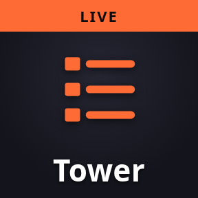 | 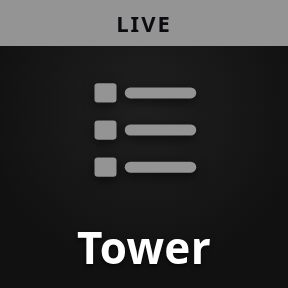 |
| Live | **Schnellste Runde** Fastest Lap | `5005` `/fastest` | [`fastest.html`](obs_loaders/fastest.html) | 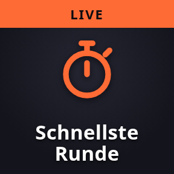 | 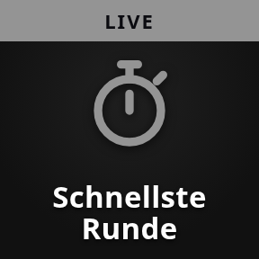 |
| Live | **Movers** Biggest Movers | `5005` `/movers` | [`movers.html`](obs_loaders/movers.html) | 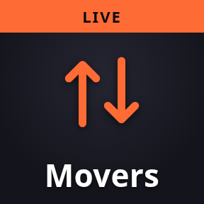 | 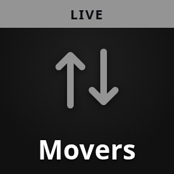 |
| Live | **Gap Bar** | `5005` `/gapbar` | [`gapbar.html`](obs_loaders/gapbar.html) |  | 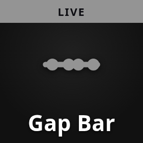 |
| Live | **Reifen Stopp** Pit Stop Tires | `5005` `/pittires` | [`pittires.html`](obs_loaders/pittires.html) | 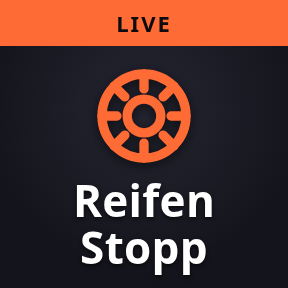 | 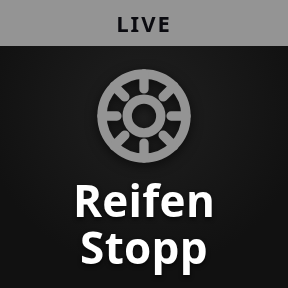 |
| Live | **Reifen Liste** Pit Stops Tire List | `5005` `/pittires/list` | [`pittires_list.html`](obs_loaders/pittires_list.html) | 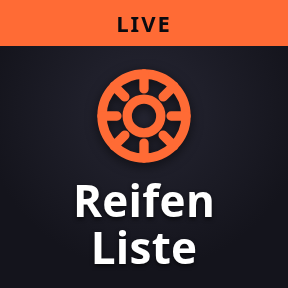 | 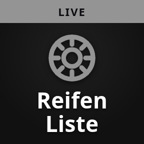 |
| Live | **Überhol Ticker** Overtake Ticker | `5000` `/ticker` | [`ticker.html`](obs_loaders/ticker.html) |  | 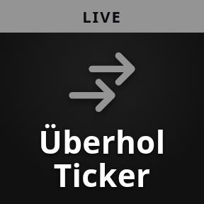 |
| Live | **Kommentar** Commentary (REGIE) | `5000` `/commentary/overlay` | [`commentary.html`](obs_loaders/commentary.html) |  |  |
| Live | **Stimme** Commentary Voice (REGIE) | `5000` `/commentary/voice` | [`commentary_voice.html`](obs_loaders/commentary_voice.html) | 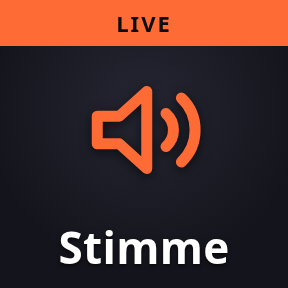 | 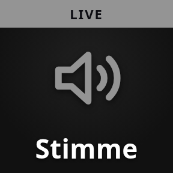 |
| Live | **Driver Card** | `5017` | [`driver.html`](obs_loaders/driver.html) |  | 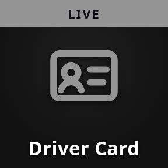 |
| Live | **Driver Card simpel** Driver Card (no iRating / SR) | `5017` `/simple` | [`driver_simple.html`](obs_loaders/driver_simple.html) |  | 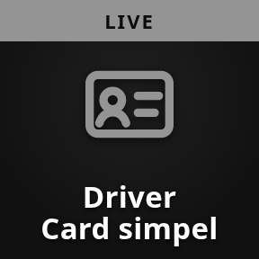 |
| Live | **Livery** | `5006` | [`livery.html`](obs_loaders/livery.html) |  |  |
| Live | **Track Map** | `5007` | [`trackmap.html`](obs_loaders/trackmap.html) | 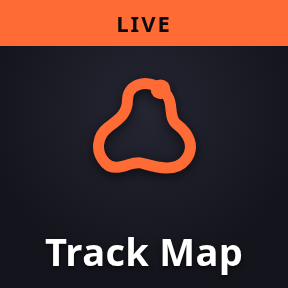 | 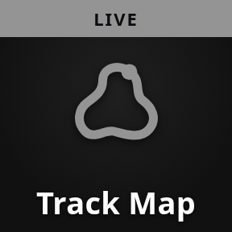 |
| Vor dem Rennen | **Streckenort** Track Location Map | `5007` `/location` | [`location.html`](obs_loaders/location.html) | 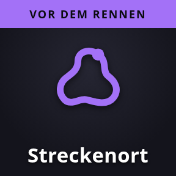 | 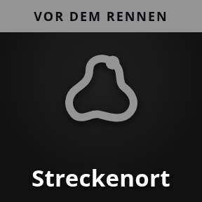 |
| Live | **Flaggen** Flag | `5008` | [`flag.html`](obs_loaders/flag.html) | 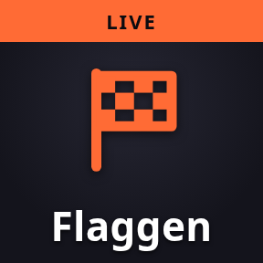 | 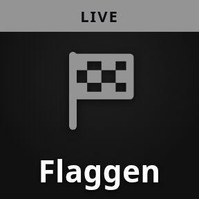 |
| Live | **Neuer Führender** New Race Leader | `5018` | [`leader.html`](obs_loaders/leader.html) | 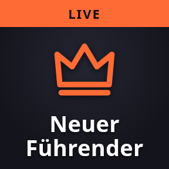 | 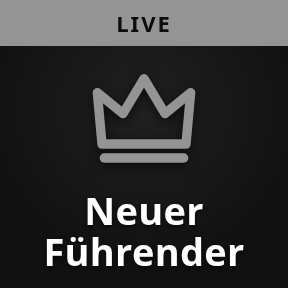 |
| Live | **Wetter** Weather | `5016` | [`weather.html`](obs_loaders/weather.html) | 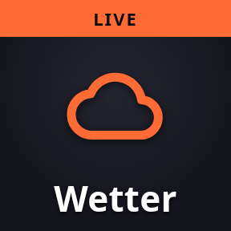 | 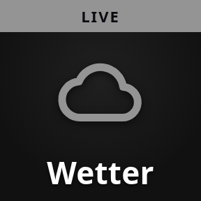 |
| Live | **Restzeit** Session Info | `5011` | [`sess.html`](obs_loaders/sess.html) | 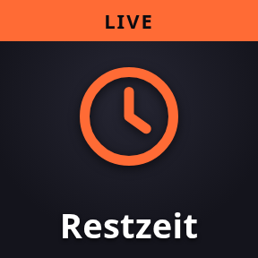 | 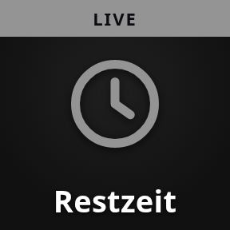 |
| Live | **LIVE / Replay** Live Indicator | `5004` | [`live.html`](obs_loaders/live.html) |  | 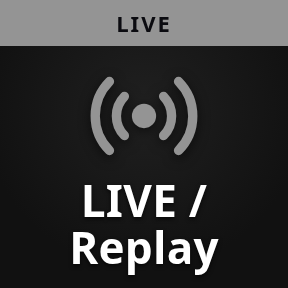 |
| Live | **Kurve** Turn Label | `5012` `/turn` | [`turn.html`](obs_loaders/turn.html) | 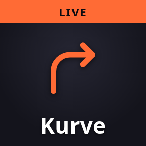 | 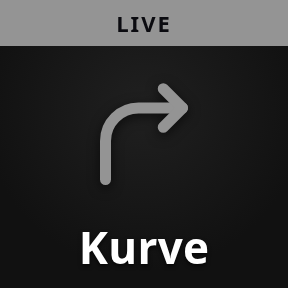 |
| Live | **Top Speed** Sector Top Speed | `5014` `/speed` | [`topspeed.html`](obs_loaders/topspeed.html) | 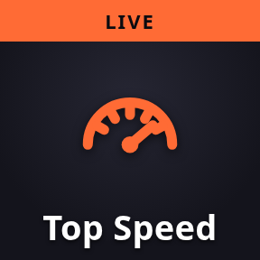 | 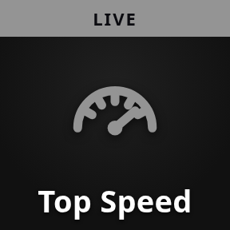 |
| Live | **Renn-Grafik** Race Logger Chart | `5009` `/chart/render` | [`logger_chart.html`](obs_loaders/logger_chart.html) | 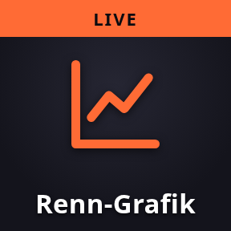 | 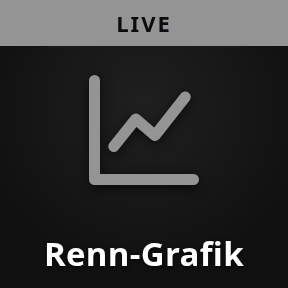 |
| Live | **Twitch Chat** Twitch Chat + viewer count | — (eigenständig) | [`twitch_chat.html`](obs_loaders/twitch_chat.html) |  |  |
| Live | **YouTube** YouTube picture-in-picture | `5005` `/youtube` | keiner — URL-Quelle `http://localhost:5005/youtube` |  |  |
| Zweikampf | **Catch-Up** Catch-Up Battle | `5015` | [`catch.html`](obs_loaders/catch.html) | 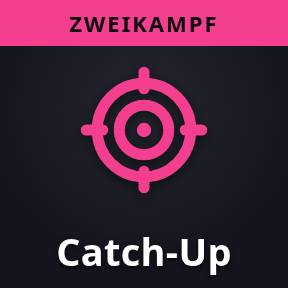 | 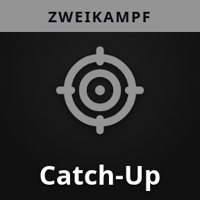 |
| Zweikampf | **Abstand** Battle: Current Gap | `5015` `/gap` | [`battle_gap.html`](obs_loaders/battle_gap.html) | 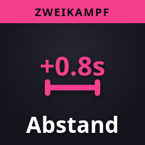 | 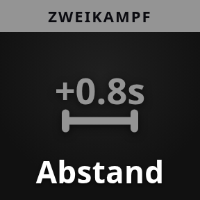 |
| Zweikampf | **Chasing** Battle: Chasing | `5015` `/chasing` | [`chasing.html`](obs_loaders/chasing.html) | 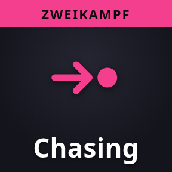 | 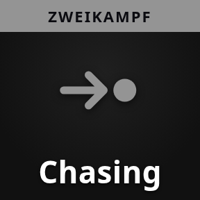 |
| Zweikampf | **Letzte 4 Runden** Battle: Last 4 Laps | `5015` `/laps` | [`last_laps.html`](obs_loaders/last_laps.html) | 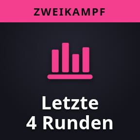 | 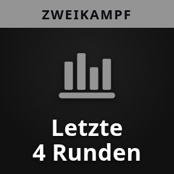 |
| Meisterschaft | **Meisterschaft** Championship | `5010` `/overlay` | [`champ.html`](obs_loaders/champ.html) | 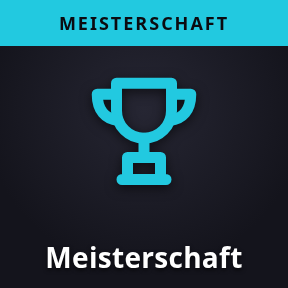 | 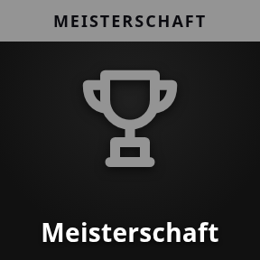 |
| Meisterschaft | **Titelkampf** Title Fight | `5010` `/duel` | [`duel.html`](obs_loaders/duel.html) | 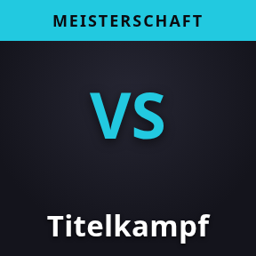 | 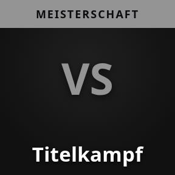 |
| Meisterschaft | **Driver of the Day** | `5013` | [`dotd.html`](obs_loaders/dotd.html) |  |  |
| Qualifying | **Delta Pole** Quali Delta | `5014` | [`delta.html`](obs_loaders/delta.html) | 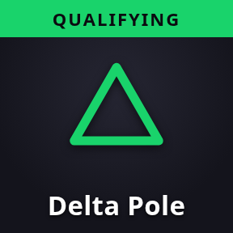 | 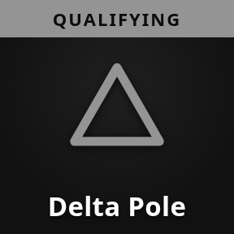 |
| Qualifying | **Delta eigene** Quali Delta (Own Best) | `5014` `/own` | [`delta_own.html`](obs_loaders/delta_own.html) | 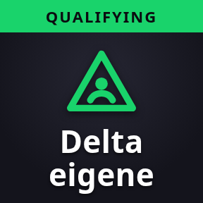 |  |
| Qualifying | **Start Grid** Grid | `5001` | [`grid.html`](obs_loaders/grid.html) |  |  |
| Qualifying | **Beste Sektoren** Best Sectors | `5014` `/sectors` | [`sectors.html`](obs_loaders/sectors.html) |  |  |
| Vor dem Rennen | **Letzte Runde** Last Round Results | `5010` `/lastrace` | [`lastrace.html`](obs_loaders/lastrace.html) |  |  |
| Vor dem Rennen | **Tabelle** Standings Before Round | `5010` `/table` | [`table.html`](obs_loaders/table.html) |  |  |
| Vor dem Rennen | **Letzte Runde PRO** Last Round Results PRO | `5010` `/lastrace/pro` | [`lastrace_pro.html`](obs_loaders/lastrace_pro.html) |  |  |
| Vor dem Rennen | **Letzte Runde AM** Last Round Results AM | `5010` `/lastrace/am` | [`lastrace_am.html`](obs_loaders/lastrace_am.html) |  |  |
| Vor dem Rennen | **Tabelle PRO** Standings Before Round PRO | `5010` `/table/pro` | [`table_pro.html`](obs_loaders/table_pro.html) |  |  |
| Vor dem Rennen | **Tabelle AM** Standings Before Round AM | `5010` `/table/am` | [`table_am.html`](obs_loaders/table_am.html) |  |  |
| Vor dem Rennen | **RSVP** RSVP Overview | `5010` `/rsvp` | [`rsvp.html`](obs_loaders/rsvp.html) |  |  |
| Vor dem Rennen | **Statistik** Season Statistics | `5010` `/stats` | [`stats.html`](obs_loaders/stats.html) |  |  |
| Vor dem Rennen | **DotD letzte Runde** Last Round Driver of the Day | `5010` `/lastdotd` | [`lastdotd.html`](obs_loaders/lastdotd.html) |  |  |
| Nach dem Rennen | **Ergebnis** Results | `5002` | [`results.html`](obs_loaders/results.html) |  |  |
| Nach dem Rennen | **Ergebnis Lite** Results Lite | `5003` | [`results_lite.html`](obs_loaders/results_lite.html) |  |  |
| Nach dem Rennen | **Ergebnis Abspann** Results (Abspann, opaque) | `5002` `/solid` | [`results_solid.html`](obs_loaders/results_solid.html) |  |  |
| Nach dem Rennen | **Meisterschaft Abspann** Championship (Abspann, opaque) | `5010` `/overlay/solid` | [`champ_solid.html`](obs_loaders/champ_solid.html) |  |  |
| Nach dem Rennen | **Highlight Titel** Highlight Title Card | `5000` `/highlights/card` | [`highlight_card.html`](obs_loaders/highlight_card.html) |  |  |
| Bedienung | **Dashboard** | `5000` | [`dashboard.html`](obs_loaders/dashboard.html) |  |  |
| Bedienung | **Race Logger** | `5009` | [`logger.html`](obs_loaders/logger.html) |  |  |
| Bedienung | **Corner Cues** | `5012` | [`line.html`](obs_loaders/line.html) |  |  |

Bedienseiten (kein OBS): Überhol-Fenster `http://localhost:5000/overtakes/panel` , Race Control `http://localhost:8080`. Kamera- und Replay-Tasten: [streamdeck_icons/README.md](streamdeck_icons/README.md).
